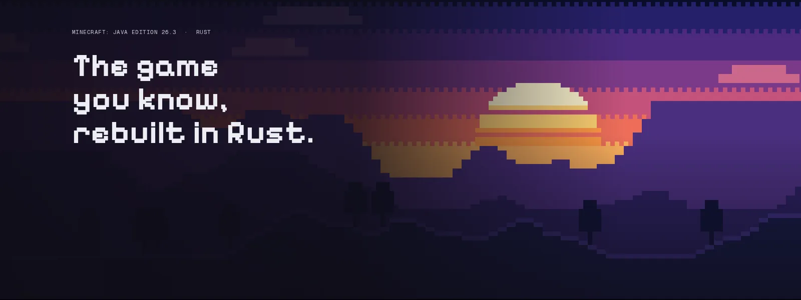
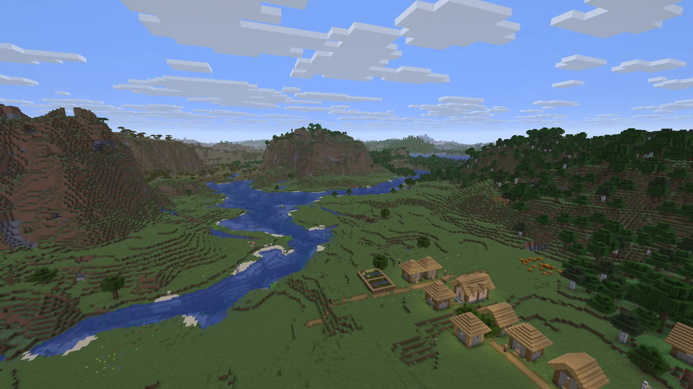

  

  
  

# Horizon Crack

allows you to use horizon launcher without microsoft account 

## Launcher downloads

Choose the download for your computer from the
[GitHub Releases page](https://github.com/invisbleia/horizon-cracked/releases):

| Operating system | Which file to download |
| --- | --- |
| Windows | `horizon-launcher-setup.exe` |
| Windows (ARM-based PC) | `horizon-launcher-setup-arm64.exe` (may not be available in every release) |
| macOS (Apple Silicon) | `horizon-launcher-macos-arm64.dmg` |
| macOS (Intel) | `horizon-launcher-macos-x64.dmg` |
| Linux | `horizon-launcher-linux-x86_64.AppImage` (recommended) or `horizon-launcher-linux-x86_64.tar.gz` |

  

